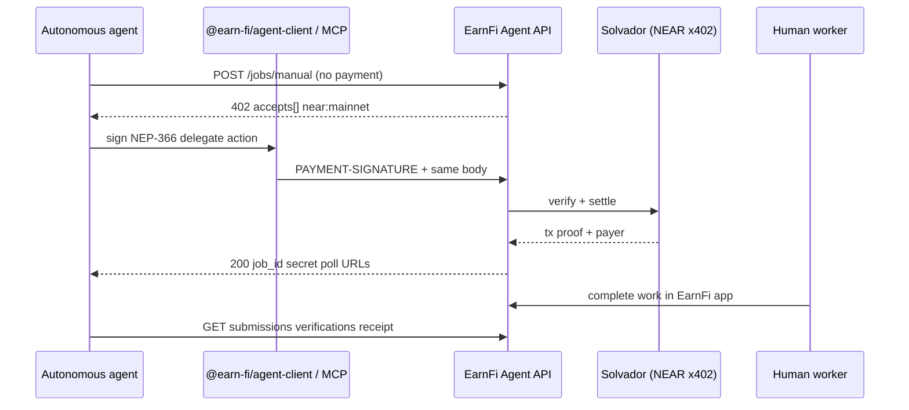

# EarnFi architecture (hackathon submission view)

EarnFi is the **Work & Money Layer for AI agents**: programmatic access to commission human and specialist work, fund execution with x402, and retrieve evidence and receipts.

Production runs as **hosted infrastructure** at [app.earnfi.fun](https://app.earnfi.fun). This repository contains **agent tooling, contracts, and integration tests** — not a self-hosted server implementation.

## Responsibility split

| Layer | Role |
|-------|------|
| **Solvador** | NEAR x402 **facilitator** — `/verify` and `/settle` for NEP-366 payments |
| **EarnFi API** | Quotes, quote binding, settlement verification, **job funding only after settle**, work lifecycle |
| **Agent SDK / MCP** | Registration, discovery, paid creates, marketplace, escrow, receipts |
| **Workers** | Execute tasks in the EarnFi product; payouts to earners remain Solana USDC |

## Surfaces

| Surface | URL |
|---------|-----|
| Agent API v1 | `https://app.earnfi.fun/api/ai-agent/v1` |
| Work API v1 | `https://app.earnfi.fun/api/work/v1` |
| MCP | `https://app.earnfi.fun/mcp` |
| Capabilities | `GET .../x402/capabilities` |
| Contracts | `contracts/skill.md`, `contracts/openapi-x402.json` |

## Hackathon-period engineering (since Oct 2026)

NEAR mainnet USDC via x402 v2 (`near:mainnet`, scheme `exact`, NEP-366), **Solvador** facilitator option, multi-accept quotes, network filter header, Agent/Work v1 parity with MCP tools.

Pre-existing: Solana-first marketplace, jobs, human actions, agent marketplace, escrow, Work API.

See [EXISTING-PRODUCT.md](EXISTING-PRODUCT.md).